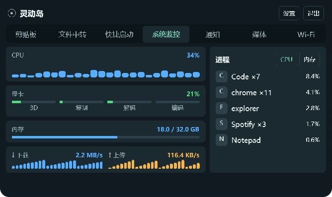

# Win Island

[简体中文](README.md)

Win Island is a Windows 10 x64 desktop overlay built with Rust and GPUI Kit. It stays flush with the top of the primary display, expands on hover, and retracts when the pointer leaves. Use it to check notifications, control media and wireless connections, revisit clipboard items, stage files, launch apps, and monitor system resources.

## Screenshots

Incoming notifications take priority in the collapsed preview. Media, Wi-Fi, and Bluetooth each have compact, detailed, and hidden preview settings. With nothing to preview, the island collapses into a black bar.


Scroll over the tab bar to cycle through visible tabs. The system monitor shows CPU, GPU, memory, network throughput, and the top processes at a glance.



The clipboard can show image thumbnails and ordinary filenames in the same entry. The Copy button lets you paste the original files back into File Explorer.


## Features

| Tab | What you can do |
| --- | --- |
| Notifications | Read app and system notifications retained in Windows Notification Center. Click an entry to open the source app and dismiss it after a successful launch, or clear all notifications. Windows Notification Center handles the original notification deep links. Notification content is held in memory. |
| Media | Play, pause, and skip tracks in the active Windows media session. Both playing and paused tracks can appear in the collapsed preview. Adjust the default output volume with the mouse wheel over the volume control, the slider, the volume buttons, or mute. |
| Wi-Fi | Scan nearby networks, view signal strength, connect to saved or open networks, and disconnect. The current network's upload and download rates update every second. Use Windows Wi-Fi settings when a network requires credentials on first connection. |
| Bluetooth | Connect and disconnect supported classic headsets and speakers through Windows audio endpoints. For supported Bluetooth Low Energy devices, open and release GATT sessions. Battery levels appear when available. The collapsed preview shows the lowest reported battery level. |
| Clipboard | View text, images, and files copied during the current session. PNG, JPEG, WebP, GIF, BMP, TIFF, and ICO files show thumbnails and filenames. Copy entries again, pause recording, clear the history, or set a maximum history size. |
| File shelf | Drag files or folders onto the island to open the shelf and stage their original paths. Hold Ctrl when dragging out to copy, or Shift to move. A successful move removes the shelf entry. Copy All also works with File Explorer. |
| Quick launch | Add applications or shortcuts and launch them from the island. The list persists across restarts. |
| System monitor | Watch CPU, GPU, memory, and network metrics update every second. Sort processes by CPU or memory. GPU readings depend on the availability of Windows performance counters. |
| Settings | Choose visible tabs, clipboard history size, launch at sign-in, hover delays, animations, and collapsed preview styles. |

## Build and run

You need Windows 10 version 2004 (build 19041) or later, the x64 Rust MSVC toolchain, Visual Studio's Desktop development with C++ workload, the Windows SDK, and CMake. Run this in PowerShell. On the first run, Cargo downloads the pinned dependencies.

```powershell
cargo run --locked
```

## Portable setup

Open `WinIsland-Portable.exe` and expand the Notifications tab. If Windows prompts for access, select 「配置通知权限」 (Configure notification access). If access was disabled, open 「通知隐私设置」 (Notification privacy settings) to restore it.

To start Win Island when you sign in, open 「设置」 (Settings) and enable 「登录后自动启动」 (Launch at sign-in). If you move the EXE, use the same setting to update its startup path.

### Build the portable executable

```powershell
cargo build --locked --release --target x86_64-pc-windows-msvc
```

Copy `target\x86_64-pc-windows-msvc\release\win-island.exe` to `dist\WinIsland-Portable.exe`.

## Implementation references

- [GPUI Kit installation requirements](https://gpui-kit.com/docs/installation/)
- [Windows Notification Listener](https://learn.microsoft.com/en-us/windows/uwp/design/shell/tiles-and-notifications/notification-listener)
- [Windows media transport controls](https://learn.microsoft.com/en-us/uwp/api/windows.media.control.globalsystemmediatransportcontrolssessionmanager)
- [Windows Native Wi-Fi](https://learn.microsoft.com/en-us/windows/win32/nativewifi/native-wifi-functions)
- [Windows Bluetooth GATT client](https://learn.microsoft.com/en-us/windows/uwp/devices-sensors/gatt-client)
- [Windows Bluetooth audio connection control](https://learn.microsoft.com/en-us/windows-hardware/drivers/audio/kspropsetid-btaudio)
